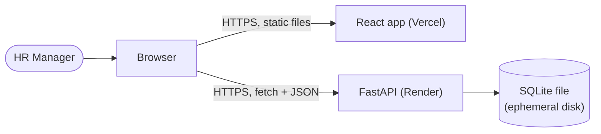

# ACME Salary Manager

A salary management app for ACME's HR Manager, replacing an Excel-based
workflow for tracking and reviewing pay across roughly 10,000 employees
in multiple countries: browse, search and edit individual records, and
see salary insights by country, department and job title.

## Live demo

- App: https://acme-salary-manager.vercel.app/
- API: https://acme-salary-manager-7nys.onrender.com (interactive docs at
  [`/docs`](https://acme-salary-manager-7nys.onrender.com/docs))

Reviewer HR credentials are provided in the submission email.

Both run on free-tier hosting:

- **Cold start:** if nobody has used it for 15+ minutes, Render stops
  the backend; the first request after that wakes it again, which can
  take about 30-60 seconds. Opening the API's `/health` URL first, then
  reloading the app, is the quickest way through it.
- **Data resets on restart.** The backend stores data in a SQLite file
  on Render's free-tier disk, which is not persistent -- every restart
  (a redeploy, or a cold start after idling) loses it, and the backend
  reseeds the same 10,000 employees automatically. Anything added or
  edited through the UI doesn't survive a restart.

## Features

- Browse all employees with server-side search, filters (country,
  department, job title), sorting, and pagination.
- Add, edit, and delete employees, with server-side validation and
  field-level error messages.
- Salary insights by country, department, and job title: headcount, min,
  max, average, median, and a 10-bucket salary distribution.
- Seeded with 10,000 deterministic employees across multiple countries.

## Tech stack

**Backend:** Python 3.12, FastAPI, SQLAlchemy 2.x, SQLite, pytest, ruff,
mypy, [uv](https://github.com/astral-sh/uv). FastAPI for typed routes and
automatic request validation; SQLAlchemy with a schema kept
Postgres-compatible, since SQLite is a demo-scale choice, not a
production one (see [Known limitations](#known-limitations-and-next-steps)).

**Frontend:** React + TypeScript (strict), Vite, MUI, TanStack Query,
Vitest + React Testing Library + MSW. TanStack Query for server-state
caching and request deduplication instead of hand-rolled `useEffect`
data fetching; MUI for a complete, accessible component set rather than
building table/dialog/form primitives from scratch.

## Architecture



Backend layering (`router -> service -> repository -> model`) and a
sequence diagram of login followed by an authenticated write, with the
validation and error-mapping paths: [docs/architecture.md](docs/architecture.md).
Data model, conversion rules and trade-offs: [docs/design-notes.md](docs/design-notes.md).

## Run locally

### Backend

```bash
cd backend
uv sync
cp .env.example .env
# Edit .env: fill in HR_USERNAME, HR_PASSWORD, and AUTH_SECRET_KEY (the
# file's own comment shows a command to generate AUTH_SECRET_KEY), and
# set SEED_ON_EMPTY=true -- it defaults to false, so a fresh clone
# otherwise starts with an empty employee table.
# DATABASE_URL and CORS_ALLOWED_ORIGINS already have working local defaults.
uv run --env-file .env uvicorn app.main:app --reload
```

`--env-file .env` is required -- plain `uv run` does not read `.env` on
its own, and without it the app fails fast with "AUTH_SECRET_KEY
environment variable must be set" (verified: this is what actually
happens, not a hypothetical).

The API is then at http://localhost:8000 (interactive docs at `/docs`).

**Seed data:** there is no standalone seed script -- seeding happens only
via `SEED_ON_EMPTY=true` at startup (above), when the employees table is
empty. Measured: 0.16s on a laptop with a local SQLite file, about 2.9s
on Render's free tier, both for 10,000 employees.

### Frontend

```bash
cd frontend
yarn install
echo "VITE_API_URL=http://localhost:8000" > .env.local
yarn dev
```

Opens at http://localhost:5173.

### Running both together

Start the backend first (above), then the frontend in a second terminal
pointed at it via `VITE_API_URL`. Log in with the `HR_USERNAME`/
`HR_PASSWORD` you set in `backend/.env`.

## Tests

```bash
# Backend (from backend/)
uv run pytest
uv run ruff check . && uv run ruff format --check .
uv run mypy

# Frontend (from frontend/)
yarn test
yarn lint
yarn typecheck
yarn build
```

Current counts from a fresh run: **434 backend tests**, **178 frontend
tests**, both passing; ruff, mypy, eslint, and `tsc` all clean.

## API overview

All responses are JSON. Every `GET` is public; `POST`/`PUT`/`DELETE`
require `Authorization: Bearer <token>` from `POST /auth/login`.

| Method | Path | Purpose | Auth |
|---|---|---|---|
| GET | `/health` | Liveness check | Public |
| POST | `/auth/login` | Exchange username/password for a token (3600s) | Public |
| GET | `/employees` | List, with `q`/`country`/`department`/`job_title` filters, sort, and pagination | Public |
| GET | `/employees/options` | Distinct countries/departments/job titles, for filter/autocomplete options | Public |
| GET | `/employees/{id}` | Fetch one employee | Public |
| POST | `/employees` | Create an employee | Required |
| PUT | `/employees/{id}` | Replace an employee | Required |
| DELETE | `/employees/{id}` | Delete an employee | Required |
| GET | `/insights/country` | Headcount/min/max/average/median/distribution per country | Public |
| GET | `/insights/department` | Same, per department | Public |
| GET | `/insights/job-title` | Same, per job title | Public |
| GET | `/meta/countries` | Supported countries with their currency and decimal places | Public |

## Key decisions and trade-offs

Full detail and reasoning: [docs/design-notes.md](docs/design-notes.md).

- **Money is integer minor units**, never float -- local currency is the
  source of truth, with a derived USD copy for cross-country insights.
  One shared half-even rounding helper is used everywhere a value is
  rounded (conversion, averages, median).
- **One fixed currency per country, with fixed USD rates, not live FX** --
  a country/currency mismatch can't be entered, and results stay
  deterministic for the tests. Changing a rate requires a recompute step
  over the stored USD column.
- **Only `full_name`, `hire_date`, and the USD salary column are
  sortable.** Local-currency salaries aren't comparable across employees
  paid in different currencies, so that column is deliberately excluded
  from sorting.
- **Median and average use half-even rounding**, not floor division or
  round-half-up, so rounding error doesn't drift in one direction across
  thousands of rows.
- **Distribution buckets use a ceiling-width rule** (`width = (n + 9) //
  10`, all-integer), always exactly 10 buckets, with the last non-empty
  bucket's upper bound clamped to the true maximum.
- **A single shared HR login** from environment variables, not per-user
  accounts -- acceptable because the data is synthetic and there's no
  role management in scope (one persona, nobody to approve).
- **Reads are public; only writes require a token.** Browsing and
  insights don't need a login; add/edit/delete do.
- **Offset pagination**, adequate at 10,000 rows with indexed sort
  columns.
- **Search is a case-insensitive `LIKE '%q%'` on name and email, not
  indexed.** A leading-wildcard `LIKE` can't use a B-tree index on either
  SQLite or Postgres regardless, and a full scan of 10,000 rows takes a
  few milliseconds -- not worth a `pg_trgm`-style index until it's
  actually measured as slow.

## Performance

Measured, not estimated (see [docs/design-notes.md](docs/design-notes.md)
for the methodology):

- **Seed:** 0.16s locally (file-based SQLite), 2.90s on Render's free tier,
  for 10,000 employees.
- **`GET /employees`**, filtered and sorted, at 10,000 rows: 2-4ms.
- **Each `/insights/*` endpoint**, at 10,000 rows: ~15-16ms (5-run
  average), always exactly 2 SQL queries per request.
- A dedicated test asserts `EXPLAIN QUERY PLAN` actually uses the
  `country` index for a filtered, sorted page -- not just "some index,"
  the specific one -- so this stays true as the code changes, not just
  true today.
- The insights dashboard's chart library is lazy-loaded with the
  `/insights` route: its own JS chunk (~323kB, gzip ~101kB) only
  downloads when someone opens that page, isolated from the main bundle.

## How AI was used

Every slice of this project (backend and frontend) was built test-first
with Claude Code, with mutation checks confirming each new test actually
fails for the right reason before the implementation lands, and a
separate Claude chat reviewing designs, reports, and (for the frontend,
which Claude Code can't see rendered) my own screenshots. The full
session-by-session log, including corrections, rejected suggestions, and
what I learned from each one, is in [docs/ai-log.md](docs/ai-log.md). The
prompts themselves, skimmable in a few minutes, are in
[docs/prompts.md](docs/prompts.md).

## Known limitations and next steps

- **The database resets on every restart** -- SQLite on Render's
  free-tier ephemeral disk. The schema is kept Postgres-compatible so
  moving to a persistent Postgres database (a paid Render disk, or a
  hosted instance) is the fix, not a rewrite.
- **No login rate limiting or token revocation.** A wrong password costs
  nothing to retry, and a token is valid until it expires, full stop --
  acceptable for a single shared demo login, not for a real
  multi-tenant system.
- **CSV export and import are not built** (the brief's own stretch goal,
  only if time allowed).
- **Salary history and audit trail are deliberately out of scope** -- see
  [docs/requirements.md](docs/requirements.md) for the reasoning.
