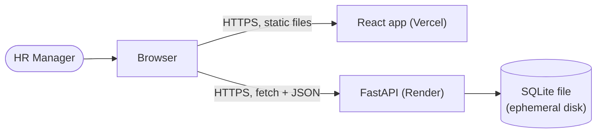
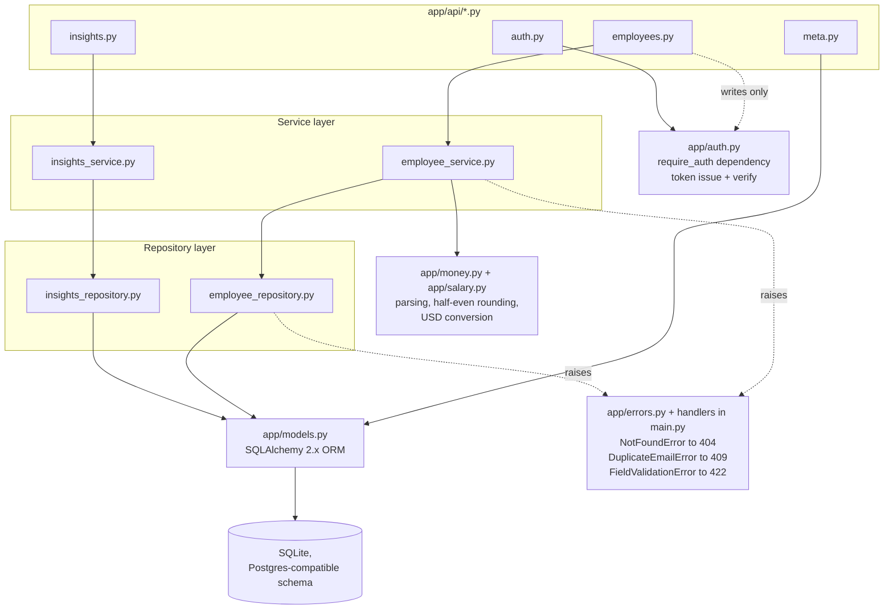
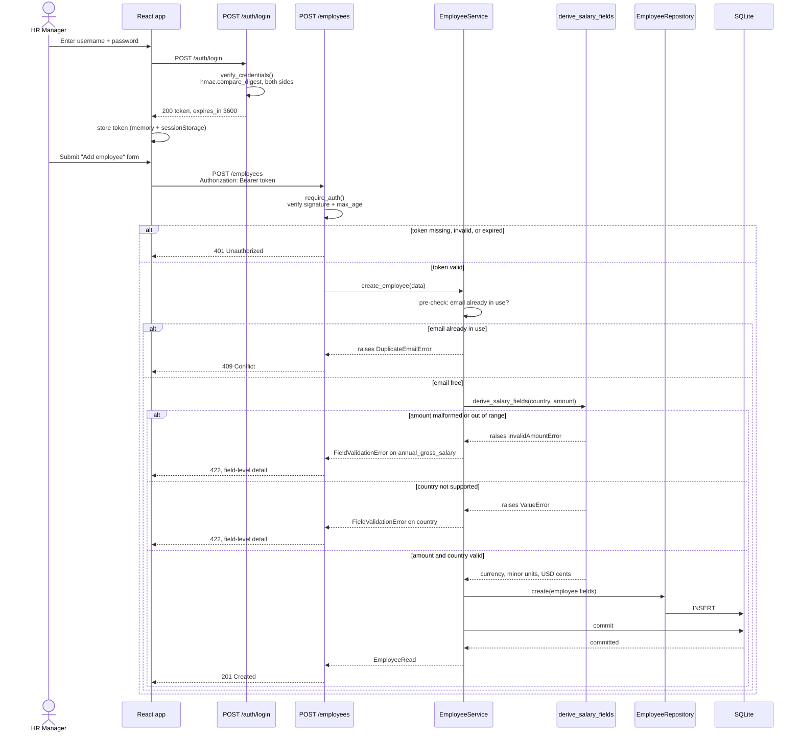

# Architecture

How the pieces fit together, and how one request (login, then an
authenticated write) flows through them. For the data model, conversion
rules and trade-offs, see [design-notes.md](design-notes.md).

## System

A single-page React app, served as static files from Vercel, talks
directly to the FastAPI API on Render over HTTPS. The browser is the only
thing that ever calls the API -- Vercel does not proxy requests.

SQLite's disk on Render's free tier is not persistent: the file resets on
every restart, so the backend reseeds 10,000 deterministic employees at
startup when the table is empty (`SEED_ON_EMPTY=true`). See
[deployment.md](deployment.md).

## Backend layering

`router -> service -> repository -> model`, so business logic is
unit-testable without HTTP or a real database (CLAUDE.md). Error handlers
and the auth dependency sit outside that chain: routers don't `try`/`except`
anything themselves, and writes declare `Depends(require_auth)` rather
than checking auth inline.

Notes:
- `app/money.py` holds the currency-agnostic primitives (parsing a decimal
  string to minor units, the one half-even rounding helper, USD-cents
  conversion); `app/salary.py`'s `derive_salary_fields` is the single
  write-path entry point that calls them, used identically by create,
  update, and the seed generator.
- `app/errors.py` defines plain exceptions the service layer raises
  (`NotFoundError`, `DuplicateEmailError`, `FieldValidationError`); the
  handlers that translate them to HTTP responses are registered once, in
  `app/main.py`, so no router needs its own `try`/`except`.
- Reads (`GET /employees`, `GET /employees/options`,
  `GET /employees/{id}`, all three `/insights/*`, `GET /meta/countries`)
  are public. Only `POST`/`PUT`/`DELETE` on `/employees` require
  `Depends(require_auth)`.

## Sequence: login, then an authenticated create

The 422 shape matches Pydantic's own per-field error format
(`{"detail": [{"loc": ["body", "<field>"], "msg": ..., "type":
"value_error"}]}`), so the frontend maps every validation error --
schema-shape ones from Pydantic itself, and business-rule ones from
`FieldValidationError` -- through the same code path
(`src/utils/apiErrorToFieldErrors.ts`). The commit itself is also wrapped:
if two requests somehow race past the pre-check with the same email, the
database's own unique constraint raises `IntegrityError` on commit, which
is caught and re-raised as the same `DuplicateEmailError` -> 409, so the
race case reaches the client the same way the common case does.
